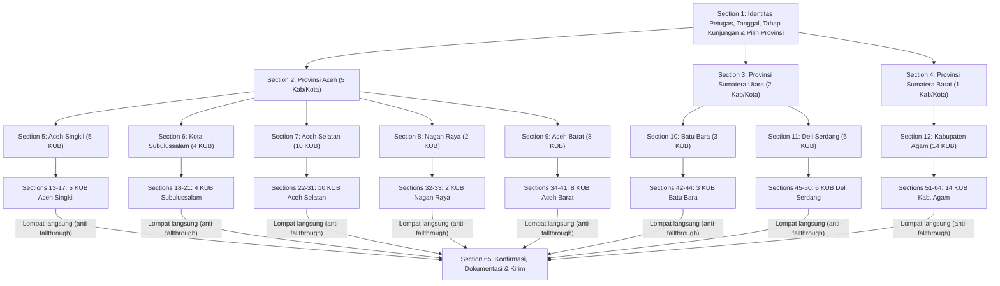

# Product Requirements Document (PRD)
## Sistem Pembuat Google Form Otomatis Monitoring & Verifikasi Bantuan Mesin/Peralatan PRRP Sumatera TA 2026 (Dit. LMEA)

| Atribut | Detail |
|---|---|
| **Nama Produk** | Generator Google Form Cascading Otomatis PRRP Sumatera TA 2026 |
| **Pemilik / Unit** | Direktorat Industri Logam, Mesin, Elektronika, dan Alat Angkut (Dit. LMEA) |
| **Google Form Target ID** | `1INekzyoSYl8kyVxK-umT3U83p09TqfvcvnSjczITiug` |
| **Link Editor Google Form** | https://docs.google.com/forms/d/1INekzyoSYl8kyVxK-umT3U83p09TqfvcvnSjczITiug/edit |
| **Google Apps Script ID** | `1adi3AvDHNYsO6n_u6fSy-rUn51tL9ilwpirdP62Lqux69MxDt6vwuxyQ` |
| **Link Editor Apps Script** | https://script.google.com/home/projects/1adi3AvDHNYsO6n_u6fSy-rUn51tL9ilwpirdP62Lqux69MxDt6vwuxyQ/edit |
| **Sumber Data Primer** | `Database Spek Mesin.xlsx` & `IK (Dit LMEA) Penerima PRRP Sumatera TA 2026.xlsx` |
| **Arsitektur Sistem** | Hybrid Apps Script (Embedded Excel Payload + Google Sheets Two-Way Sync) |
| **Versi Dokumen** | 1.0 — Lengkap & Terimplementasi |

---

## 1. Ringkasan Eksekutif & Tujuan Produk

Dokumen ini mendefinisikan spesifikasi produk, aturan data, arsitektur teknis, dan panduan operasional untuk **Sistem Pembuat Google Form Otomatis** program bantuan mesin/peralatan **PRRP Sumatera Tahun Anggaran 2026**.

Sistem dibangun untuk mengubah dua berkas Excel master (`Database Spek Mesin.xlsx` dan `IK (Dit LMEA) Penerima PRRP Sumatera TA 2026.xlsx`) menjadi sebuah **Google Form bertingkat (*cascading branching*)** sebanyak **65 Section** secara otomatis melalui Google Apps Script. Dengan mekanisme ini, petugas lapangan hanya melihat wilayah, KUB, daftar anggota IK, serta rincian mesin milik KUB yang dipilih tanpa tercampur data KUB lain, sekaligus memungkinkan pembaruan form di masa depan baik melalui skrip data tertanam maupun sinkronisasi Google Sheets.

### Tujuan Utama
1. **Menghilangkan input/pembuatan form manual** untuk **52 KUB**, **523 anggota IK**, dan **443 baris spesifikasi mesin (418 entri unik)** lintas **3 Provinsi** dan **8 Kabupaten/Kota**.
2. **Menyediakan navigasi berjenjang (*cascading*)** dari `Provinsi -> Kab/Kota -> Nama KUB -> Data Khusus KUB -> Penutup & Submit` sehingga bebas dari kebocoran daftar KUB lain.
3. **Menampilkan 100% atribut Excel** di dalam form (seluruh 18 kolom profil IK dan 11 kolom spesifikasi teknis mesin) beserta instrumen verifikasi fisik lapangan.
4. **Menjamin keandalan operasional** dengan pendekatan *Hybrid* (siap pakai langsung dari data Excel tertanam + mendukung sinkronisasi ulang dari Google Spreadsheet) serta *resumable batching* agar kebal terhadap batas waktu eksekusi 6 menit Google Apps Script.

---

## 2. Latar Belakang & Analisis Masalah

Berdasarkan pemeriksaan terhadap kedua file Excel sumber dan **2 rekaman suara petugas/pengguna** di folder kerja (`WhatsApp Ptt 2026-11-20 at 23.43.55.ogg` dan `WhatsApp Ptt 2026-11-20 at 23.44.07.ogg`), ditemukan 4 permasalahan inti yang wajib diselesaikan:

1. **Alur Pemilihan Wilayah & KUB Masih Manual / Tidak Terfilter:**
   - Dari rekaman suara pertama: setelah petugas memilih **Provinsi**, daftar **Kabupaten/Kota** harus langsung muncul otomatis sesuai provinsi tersebut; selanjutnya setelah memilih Kab/Kota dan **Nama KUB** (misalnya KUB bengkel las), sistem harus langsung menampilkan data-data KUB tersebut secara otomatis.
2. **Data KUB Lain Masih Tampil (Kebocoran Halaman/Opsi):**
   - Dari rekaman suara kedua: pada form sebelumnya masih bersifat manual sehingga setelah memilih satu KUB (contohnya bengkel las atau KUB di Kab. Agam), masih muncul banyak KUB lain di halaman yang sama atau halaman berikutnya (*fall-through*).
3. **Data Master Terpisah di Dua Workbook dengan Skema Berbeda:**
   - `Database Spek Mesin.xlsx` menyimpan 11 kolom teknis mesin per KUB, sedangkan `IK (Dit LMEA) Penerima PRRP Sumatera TA 2026.xlsx` menyimpan 18 kolom identitas pengrajin/IK penerima. Penamaan sheet dan penamaan KUB di antara kedua file memiliki variasi ejaan, sel kosong (*merged/blank cells*), kolom tertukar, dan baris duplikat.
4. **Pemeliharaan Data Berkelanjutan:**
   - Tim memerlukan skrip yang langsung berjalan memakai data Excel saat ini (**Mode Embedded**), tetapi juga dapat dipelihara lewat Google Spreadsheet apabila di kemudian hari ada penambahan KUB, revisi anggota, atau perubahan volume/merk mesin (**Mode Sheet Sync**).

---

## 3. Alur Pengguna (*User Flow*) & Arsitektur Cascading 5 Tingkat

Google Form yang dihasilkan terdiri dari tepat **65 Section** yang terbagi ke dalam **5 Level Navigasi**:

- **Level 1 (Section 1):** Identitas Petugas & Tujuan Kunjungan + Dropdown `Pilih Provinsi` (*Required*, cabang per jawaban).
- **Level 2 (Section 2–4, total 3 Section):** Pemilihan Kabupaten/Kota per Provinsi (`Aceh`, `Sumatera Utara`, `Sumatera Barat`) menggunakan Dropdown *Required* dengan cabang per jawaban.
- **Level 3 (Section 5–12, total 8 Section):** Pemilihan Nama KUB per Kab/Kota menggunakan Dropdown *Required* dengan cabang per jawaban.
- **Level 4 (Section 13–64, total 52 Section):** Halaman khusus per KUB (1 KUB = 1 Section tersendiri). Setelah petugas mengisi verifikasi anggota IK dan mesin KUB tersebut lalu menekan **Berikutnya**, aturan `PageBreakItem.setGoToPage(closingPageBreak)` melompatkan form **langsung ke Section 65** tanpa pernah jatuh ke KUB berikutnya.
- **Level 5 (Section 65):** `Konfirmasi, Dokumentasi & Pengiriman` → **Kirim / Submit**.

---

## 4. Inventarisasi & Skema Data Sumber

Seluruh data dari kedua file Excel berhasil direkonsiliasi **52/52 KUB (100% cocok, 0 KUB tidak terpetakan)** melalui skrip ETL `scripts/build_dataset.py` dengan ringkasan sebagai berikut:

| Provinsi | Kab/Kota | Sheet Mesin ↔ Sheet IK | Jumlah KUB | Anggota IK | Mesin (Baris Mentah → Unik) |
|---|---|---|---:|---:|---:|
| Aceh | Aceh Singkil | `Aceh Singkil` ↔ `Aceh Singkil` | 5 | 109 | 21 → 21 |
| Aceh | Kota Subulussalam | `Subulussalam` ↔ `Subulussalam` | 4 | 24 | 17 → 17 |
| Aceh | Aceh Selatan | `Aceh Selatan` ↔ `Aceh Selatan` | 10 | 208 | 114 → 114 |
| Aceh | Nagan Raya | `Nagan Raya` ↔ `Nagan Raya` | 2 | 15 | 48 → 48 |
| Aceh | Aceh Barat | `Aceh Barat` ↔ `Aceh Barat` | 8 | 35 | 80 → 80 |
| Sumatera Utara | Batu Bara | `Batubara` ↔ `Batu Bara` | 3 | 5 | 23 → 15 |
| Sumatera Utara | Deli Serdang | `Deli Serdang` ↔ `Deli Serdang` | 6 | 23 | 81 → 64 |
| Sumatera Barat | Kabupaten Agam | `Agam` ↔ `Kab. Agam` | 14 | 104 | 59 → 59 |
| **TOTAL** | **8 Kab/Kota** | **8 Pasangan Sheet** | **52** | **523** | **443 → 418** |

### Skema Kolom Sumber
1. **Excel IK (`IK (Dit LMEA) Penerima PRRP Sumatera TA 2026.xlsx`) — 18 Kolom:**
   `No`, `Nama IK`, `Nama`, `Nama KUB`, `Jabatan`, `Jenis Kelamin`, `Usia`, `email`, `Telepon/HP`, `Alamat`, `Desa/Kel`, `Kecamatan`, `Kab/Kota`, `Provinsi`, `NIB`, `KBLI`, `Jenis Industri/Usaha`, `Jenis Produk`.
2. **Excel Mesin (`Database Spek Mesin.xlsx`) — 11 Kolom Logis:**
   `NO.`, `NAMA KUB`, `NAMA MESIN/ALAT`, `MERK/TIPE`, `SPESIFIKASI MESIN/ALAT`, `JENIS MESIN (PDN/TKDN/Impor)`, `TIPE MESIN (TTG/Barang Jadi)`, `SUMBER ENERGI (Listrik/Bensin/Diesel)`, `Perlu Diinstalasi (Ya/Tidak)`, `Perlu Training Operator (Ya/Tidak)`, `VOLUME & SATUAN`.

Daftar lengkap pemetaan ke-52 KUB tercatat pada file hasil audit `output/audit_report.md`.

---

## 5. Aturan Pembersihan, Normalisasi & Rekonsiliasi Data (ETL)

Untuk memastikan tidak ada satu pun baris yang terlewat atau salah pasangan, `scripts/build_dataset.py` menerapkan 12 aturan pembersihan terverifikasi:

| No | Anomali Data Mentah di Excel | Aturan Penanganan | Jumlah Terdampak |
|---:|---|---|---:|
| 1 | Kolom `NAMA KUB` kosong di seluruh 48 baris sheet `Nagan Raya` (Excel Mesin) | Pemetaan otomatis berdasarkan kolom `NO.`: nomor `1–26` → `KUB Bangkit Bersama` (kopi, padi, perabot kayu, las) dan nomor `27–48` → `KUB Jaya Makmur` (es kristal, roti/kue, interior, las) | 48 baris mesin |
| 2 | Baris mesin identik berulang di `Batubara` dan `Deli Serdang` | Agregasi otomatis berdasarkan kunci `(KUB, Nama Mesin, Merk/Tipe, Spesifikasi)` dengan menjumlahkan `Volume` dan menyimpan jejak `Raw_Row_Count`. Mesin dengan nama sama tetapi spek berbeda tetap dipertahankan terpisah | 18 grup (25 baris digabung) |
| 3 | Kolom `Nama IK` dan `Nama` tertukar di sheet `Kab. Agam` (Excel IK) | Penukaran kembali kolom B (`Nama` orang) dan kolom C (`Nama IK` usaha) khusus sheet `Kab. Agam` agar konsisten dengan 7 sheet lainnya | 104 baris IK |
| 4 | Sel `Nama KUB` kosong pada anggota ke-2 dst. (Excel IK) & mesin ke-2 dst. (sheet `Agam`) | *Forward-fill* nilai `Nama KUB` dari baris sebelumnya selama baris memiliki `Nama`/`Nama IK` atau `Nama Mesin` | 322 baris IK, 45 baris mesin |
| 5 | Baris bernomor kosong tanpa data (baris `17–36` pada `Nagan Raya` Excel IK) | Dilewati agar tidak membentuk anggota kosong | 20 baris |
| 6 | Penulisan Provinsi `NAD` pada `Aceh Selatan` | Dinormalisasi menjadi `Aceh` agar tergabung dalam 1 Provinsi `Aceh` | 208 baris IK |
| 7 | Nomor HP tanpa angka `0` di depan (`Subulussalam`, `Aceh Barat`, dll.) | Penambahan awalan `0` jika seluruh digit diawali `8` (panjang 9–13 digit) | 59 nomor HP |
| 8 | Variasi nilai `Iya` vs `Ya` pada kolom Instalasi/Training | Dinormalisasi menjadi `Ya` / `Tidak` / `-` | 65 sel |
| 9 | Typo teks (`Lsitrik` pada Subulussalam, `Produksi Lokasl` pada Aceh Selatan) | Diperbaiki menjadi `Listrik` dan `Produksi Lokal` | 4 sel |
| 10 | Kolom `VOLUME SATUAN` tergabung seperti `"2 Unit"` / `"1 Set"` di sheet `Agam` | Dipisahkan menjadi `Volume = "2"`, `Satuan = "Unit"` | 59 baris mesin |
| 11 | Kolom `SATUAN` kosong di `Batubara` padahal `VOLUME = 1` | Diberi satuan default `Unit` | 23 baris mesin |
| 12 | Penamaan KUB berbeda antar 2 file Excel (mis. `Ekvo cake and bakery` vs `KUB Evco Cake - PFBB`) | Dipetakan eksplisit 1:1 lewat tabel `KUB_CROSSMAP` (52/52 pasangan) serta menyertakan kedua nama asli Excel pada ringkasan profil KUB di form | 52 KUB |

---

## 6. Spesifikasi Fungsional Google Form

### 6.1. Section 1 — Identitas Petugas & Wilayah
- **Judul Form:** `Formulir Monitoring & Verifikasi Bantuan Mesin/Peralatan PRRP Sumatera TA 2026 (Dit. LMEA)`
- **Pengaturan Form:** Progress Bar aktif (`true`), Izinkan edit tanggapan (`true`), Tidak wajib kumpul email otomatis (`false` agar petugas lapangan fleksibel), Tampilkan tautan kirim tanggapan lain (`true`).
- **Daftar Field:**
  1. `Nama Lengkap Petugas` — *Short Answer* (`TextItem`), **Wajib**.
  2. `Instansi / Unit Kerja Petugas` — *Short Answer* (`TextItem`), **Wajib**.
  3. `Nomor HP / WhatsApp Petugas` — *Short Answer* (`TextItem`), **Wajib**.
  4. `Tanggal Kunjungan / Monitoring` — *Date* (`DateItem`), **Wajib**.
  5. `Tahap / Tujuan Kunjungan` — *Dropdown* (`ListItem`), **Wajib** (`Verifikasi Awal / Survei Kesiapan`, `Serah Terima / Pengiriman Mesin`, `Instalasi & Uji Coba (Commissioning)`, `Training Operator`, `Monitoring Pemanfaatan`).
  6. `Pilih Provinsi` — *Dropdown* (`ListItem`), **Wajib**, `Go to section based on answer`:
     - `Aceh` → Section 2 (`Wilayah Provinsi: Aceh`)
     - `Sumatera Utara` → Section 3 (`Wilayah Provinsi: Sumatera Utara`)
     - `Sumatera Barat` → Section 4 (`Wilayah Provinsi: Sumatera Barat`)

### 6.2. Level 2 — Section Provinsi (3 Section)
Setiap Section Provinsi berisi 1 pertanyaan `ListItem` **Wajib** bertajuk `Pilih Kabupaten / Kota (<Provinsi>)` dengan cabang otomatis ke Section Kab/Kota yang sesuai (Aceh: 5 Kab/Kota, Sumatera Utara: 2 Kab/Kota, Sumatera Barat: 1 Kab/Kota).

### 6.3. Level 3 — Section Kabupaten/Kota (8 Section)
Setiap Section Kab/Kota berisi 1 pertanyaan `ListItem` **Wajib** bertajuk `Pilih Nama KUB — <Kab/Kota>` yang hanya memuat daftar KUB di Kab/Kota tersebut dan bercabang langsung ke Section khusus milik KUB terpilih.

### 6.4. Level 4 — Section Khusus per KUB (52 Section)
Setiap Section KUB (`[KUB] <Nama KUB> — <Kab/Kota>`) memuat komponen berurutan berikut:
1. **Header Section (`PageBreakItem`) — Ringkasan Profil KUB:**
   Menampilkan Provinsi, Kab/Kota, Nama KUB versi Excel IK & versi Excel Mesin, Kecamatan, Desa/Kelurahan, Nama Ketua & No. HP, Jenis Industri/Usaha, Jenis Produk, KBLI, Total Anggota IK (`L`/`P`), serta Total Jenis Mesin & Total Volume.
2. **Blok Informasi (`SectionHeaderItem`, *auto-chunked* per ≤ 3.500 karakter) — Daftar Lengkap Anggota IK:**
   Memuat seluruh anggota KUB beserta 18 atribut lengkap (`No`, `Nama`, `Nama IK`, `Jabatan`, `Jenis Kelamin`, `Usia`, `Telepon/HP`, `Email`, `Alamat`, `Desa/Kel`, `Kecamatan`, `NIB`, `KBLI`, `Jenis Industri/Usaha`, `Jenis Produk`).
3. **Verifikasi Kehadiran / Keaktifan Anggota IK (`CheckboxItem`, Wajib):**
   Setiap opsi bernomor urut `1. <Nama> / <Nama IK> (<Jabatan>)` ditambah opsi penutup `Tidak ada anggota yang hadir / belum terverifikasi saat kunjungan` agar petugas tidak terblokir saat perwakilan anggota berhalangan hadir.
4. **Blok Informasi (`SectionHeaderItem`, *auto-chunked* per ≤ 3.500 karakter) — Daftar Spesifikasi Teknis Mesin/Alat:**
   Memuat seluruh jenis mesin milik KUB beserta 11 kolom lengkap (`No`, `Nama Mesin/Alat`, `Merk/Tipe`, `Volume`, `Satuan`, catatan penggabungan baris bila ada, `Jenis Mesin PDN/TKDN/Impor`, `Tipe Mesin TTG/Barang Jadi`, `Sumber Energi`, `Perlu Diinstalasi`, `Perlu Training Operator`, dan `Spesifikasi Mesin/Alat`).
5. **Verifikasi Penerimaan & Kesesuaian Spesifikasi Mesin (`GridItem`, Wajib):**
   - **Baris:** Bernomor urut `N. <Nama Mesin> — <Merk/Tipe> (<Volume> <Satuan>)` (dipotong aman maks. 120 karakter dengan tetap menjaga nomor urut unik; jika volume di Excel kosong seperti Nagan Raya, tampil `(Vol: cek fisik)`).
   - **Kolom:** `Sesuai Spek & Volume`, `Sesuai Spek (Volume Kurang)`, `Tidak Sesuai Spek`, `Belum Diterima`, `Rusak / Bermasalah`.
6. **Status Instalasi & Training Operator Mesin (`GridItem`, Wajib):**
   - **Baris:** Bernomor urut `N. <Nama Mesin> [Inst: <Ya/Tidak/-> | Train: <Ya/Tidak/->]` (maks. 120 karakter).
   - **Kolom:** `Sudah Instalasi & Training`, `Sudah Instalasi (Belum Training)`, `Belum Instalasi`, `Tidak Memerlukan`.
7. **Catatan Teknis, Selisih Volume, Nomor Seri & Kendala Mesin (`ParagraphTextItem`, Opsional):**
   Menampung catatan fisik, terutama untuk KUB Nagan Raya yang volume fisiknya diverifikasi di lapangan, maupun nomor seri & kendala mesin.
8. **Navigasi Keluar Section KUB (Anti-Fallthrough):**
   Setelah mengisi Section KUB mana pun (KUB #1 sampai #52), klik **Berikutnya** selalu menuju langsung ke **Section 65 (`Konfirmasi, Dokumentasi & Pengiriman`)**.

### 6.5. Level 5 — Section Penutup (`Konfirmasi, Dokumentasi & Pengiriman`)
1. `Nama Perwakilan KUB yang Ditemui` — *Short Answer*, **Wajib**.
2. `Jabatan & Nomor HP Perwakilan KUB` — *Short Answer*, **Wajib**.
3. `Kesiapan Lokasi, Daya Listrik & Ruang Produksi` — *Multiple Choice*, **Wajib** (`Sangat Siap...`, `Cukup Siap...`, `Belum Siap...`).
4. `Link Folder Google Drive Foto Dokumentasi / BAST (Opsional)` — *Short Answer*, **Opsional**.
5. `Catatan Umum & Rekomendasi Tindak Lanjut` — *Paragraph*, **Opsional**.
6. `Konfirmasi Petugas` — *Checkbox*, **Wajib**.

---

## 7. Arsitektur Teknis Sistem Hybrid Apps Script

Seluruh kode sumber Apps Script ditempatkan di folder `apps-script/` dan disinkronkan via `clasp` ke Script ID `1adi3AvDHNYsO6n_u6fSy-rUn51tL9ilwpirdP62Lqux69MxDt6vwuxyQ`:

| File | Peran & Tanggung Jawab |
|---|---|
| `apps-script/.clasp.json` | Konfigurasi `clasp` menuju Script ID target dan urutan push file. |
| `apps-script/appsscript.json` | Manifest runtime `V8` (`Asia/Jakarta`) dan OAuth scopes (`forms`, `spreadsheets`, `script.scriptapp`). |
| `apps-script/Config.js` | Konstanta terpusat (`PRRP_CONFIG`): `FORM_ID`, `SPREADSHEET_ID`, judul/deskripsi form, opsi pilihan, serta batas waktu `MAX_EXECUTION_MS` (220 detik). |
| `apps-script/DataPayload.js` | Dataset JSON terstruktur (`PRRP_MASTER_DATA`) hasil kompilasi otomatis `scripts/build_dataset.py` (3 Provinsi, 8 Kab/Kota, 52 KUB, 523 IK, 418 mesin). |
| `apps-script/SheetSync.js` | Implementasi **Mode Hybrid Google Sheets**: fungsi `createMasterSpreadsheetTemplate_()` untuk membangkitkan Google Spreadsheet master berformat 2 tab (`Master_IK_KUB`, `Master_Spek_Mesin`), serta `loadDataFromSpreadsheet_()` untuk membaca ulang Spreadsheet tersebut menjadi skema master identik. |
| `apps-script/FormBuilder.js` | Mesin pembuat Google Form bertahap (*state machine*: `CLEAR` → `INIT` → `KUBS` → `FINALIZE` → `DONE`) dengan penyimpanan kursor di `PropertiesService`, *time-based continuation trigger*, auto-chunking teks, dan auditor struktur `verifyFormStructure_()`. |
| `apps-script/Kode.js` | *Entry point* publik yang tampil rapi di dropdown Apps Script Editor: `buildNewFormFromEmbedded`, `buildNewFormFromSpreadsheet`, `buildFormFromEmbedded`, `buildFormFromSpreadsheet`, `continueBuildForm`, `createMasterSpreadsheetTemplate`, `verifyFormStructure`, `resetBuildState`. |

### Dua Mode Operasional (Hybrid)
1. **Mode 1 — Embedded Excel Payload (`buildNewFormFromEmbedded` / `buildFormFromEmbedded`):**
   `buildNewFormFromEmbedded` otomatis membuat Google Form baru (`FormApp.create`) di akun Drive aktif, menyimpan Form ID-nya di `ScriptProperties`, dan langsung membangun seluruh 65 section dari `PRRP_MASTER_DATA`. Untuk memperbarui form aktif yang sama, gunakan `buildFormFromEmbedded`.
2. **Mode 2 — Google Sheets Sync (`createMasterSpreadsheetTemplate` + `buildNewFormFromSpreadsheet` / `buildFormFromSpreadsheet`):**
   Admin menjalankan `createMasterSpreadsheetTemplate()` sekali untuk menghasilkan Google Spreadsheet berisi tab `Master_IK_KUB` (524 baris termasuk header) dan `Master_Spek_Mesin` (419 baris termasuk header). Apabila ada pembaruan data di kemudian hari (atau memakai file CSV template `output/template_sheet_ik_kub.csv` dan `output/template_sheet_spek_mesin.csv`), admin cukup mengubah Spreadsheet lalu menjalankan `buildFormFromSpreadsheet()` (atau `buildNewFormFromSpreadsheet()` untuk form baru).

### Mekanisme Anti-Timeout & Navigasi `PageBreakItem`
- **Penjaga Waktu 220 Detik:** Setiap fase (`CLEAR`, `INIT`, `KUBS`, `FINALIZE`) mengecek `Date.now() - startMs >= 220000`. Jika mendekati batas 6 menit (360 detik) Apps Script, status disimpan ke `PropertiesService` dan *trigger* sekali jalan menjadwalkan `continueBuildForm` 15 detik kemudian secara otomatis hingga selesai (`DONE`).
- **Aturan Off-by-One `PageBreakItem.setGoToPage()`:** Pada `FormApp`, `pb.setGoToPage(target)` mengatur navigasi *"Setelah bagian X"* untuk section **tepat sebelum** `pb`. Oleh karena itu, skrip memasang `.setGoToPage(closingPb)` pada `kubOrder[i + 1]` untuk setiap KUB `0..50`, sedangkan KUB terakhir (`51`) berada tepat sebelum `closingPb` dengan `closingPb.setGoToPage(FormApp.PageNavigationType.CONTINUE)`.

---

## 8. Batasan Platform Google Forms / Apps Script & Mitigasi

| Batasan Platform | Dampak Teknis | Mitigasi dalam Sistem |
|---|---|---|
| `FormApp` tidak menyediakan API untuk membuat pertanyaan **File Upload** (`FileUploadItem`) | Pengunggahan file/foto langsung tidak dapat dibuat lewat Apps Script | Form menyediakan field `Link Folder Google Drive Foto Dokumentasi / BAST (Opsional)` di Section Penutup; jika wajib upload langsung di form, admin dapat menambahkan 1 pertanyaan *Upload File* secara manual di akhir Section 65. |
| Batas panjang teks pada `SectionHeaderItem` & batas label baris `GridItem` | KUB dengan 25–30 anggota atau 26 mesin menghasilkan teks deskripsi hingga >9.000 karakter | `chunkTextLines_()` memecah blok teks otomatis pada batas entri maksimal **3.500 karakter** per blok; `truncateLabel_()` membatasi label baris `GridItem` maksimal **120 karakter**. |
| Larangan baris/opsi identik di `GridItem` dan `CheckboxItem` | Google Forms menolak pembangunan item jika ada dua baris/opsi sama persis | Setiap baris/opsi diawali nomor urut unik (`1. `, `2. `, ...), menjamin keunikan mutlak. |
| Batas jumlah kolom pada Spreadsheet hasil respons | Total item form ≈ 438 item akan menghasilkan **~964 kolom respons** di Google Sheets | Google Sheets mendukung hingga **18.278 kolom** per spreadsheet (~5,3% kapasitas terpakai), sehingga aman untuk ratusan hingga ribuan submit lapangan. |
| Batas waktu eksekusi Apps Script (6 menit / eksekusi) | Pembersihan dan pembuatan ~438 item dapat memakan waktu bervariasi tergantung latensi RPC Google | Diatasi penuh oleh mesin fase `CLEAR → INIT → KUBS → FINALIZE` yang *resumable* lewat `PropertiesService` dan *time trigger*. |

---

## 9. Kriteria Penerimaan (*Acceptance Criteria*) & Hasil Pengujian

### Kriteria Penerimaan
- [x] Seluruh **3 Provinsi**, **8 Kab/Kota**, **52 KUB**, **523 Anggota IK**, dan **443 baris mesin (418 entri unik)** terpetakan 100% tanpa satu pun data tertinggal.
- [x] Alur form sepenuhnya *cascading* sesuai rekaman suara (`Provinsi` → `Kab/Kota` → `Nama KUB` → data spesifik KUB tersebut → `Penutup`).
- [x] **0 kebocoran antar-KUB**: 52 dari 52 jalur KUB langsung melompat ke Section 65 (`Konfirmasi, Dokumentasi & Pengiriman`) saat klik *Berikutnya*.
- [x] Mendukung mode **Hybrid** (Embedded Excel Payload + Google Sheets Sync) dan tahan terhadap batas waktu 6 menit.
- [x] Seluruh kode terunggah rapi ke Apps Script ID target via `clasp`.

### Bukti Verifikasi Terukur (Offline & Simulasi)
1. **Audit ETL Python (`python scripts/build_dataset.py`):**
   - Output: `PASS: 3 provinsi, 8 kab/kota, 52 KUB, 523 anggota IK, 443 raw -> 418 unique machines, 0 unmatched`.
2. **Simulasi Lengkap Apps Script (`node tests/test_apps_script.js`):**
   - **Syntax Check:** Seluruh 5 file JS di `apps-script/` lolos `node --check`.
   - **Embedded Build & 52-Path Simulation:** `65 sections, 438 items, 52/52 KUB paths cleanly jump to Closing` (0 error di `verifyFormStructure()`).
   - **Auto Create New Form Test:** `buildNewFormFromEmbedded()` sukses membuat Form baru via `FormApp.create()`, menyimpan ID aktif, membangun 65 section / 52 jalur KUB valid, dan dapat diperbarui ulang lewat `buildFormFromEmbedded()`.
   - **Resumable Batching Test:** Simulasi batas waktu paksa menyelesaikan form mulus dalam **9 kali lanjutan trigger otomatis** dengan 0 trigger tersisa dan 0 kebocoran jalur.
   - **Hybrid Sheet Sync Round-Trip:** `createMasterSpreadsheetTemplate()` menghasilkan 524 baris IK & 419 baris Mesin; penambahan baris baru tanpa `KUB_ID` diuji dan `buildFormFromSpreadsheet()` tetap menghasilkan 65 section dan 52/52 jalur valid.

---

## 10. Panduan Operasional & Deployment Admin

### A. Membuat Google Form Baru Secara Otomatis (Rekomendasi Utama — 1 Menit)
1. Buka editor Google Apps Script:
   https://script.google.com/home/projects/1adi3AvDHNYsO6n_u6fSy-rUn51tL9ilwpirdP62Lqux69MxDt6vwuxyQ/edit
2. Di toolbar atas, buka file `Kode.js` lalu pilih fungsi **`buildNewFormFromEmbedded`** pada dropdown daftar fungsi di sebelah tombol *Debug*.
3. Klik **Run / Jalankan**.
4. Pada eksekusi pertama, klik **Review Permissions → Pilih akun Google aktif Anda → Allow** untuk menyetujui izin akses `Forms`, `Spreadsheets`, dan `Triggers`.
5. Pantau **Execution Log**:
   - Skrip langsung membuat Google Form baru di Drive akun aktif Anda dan mencetak `Form ID` serta `Edit URL` di bagian awal log.
   - Jika form selesai dalam satu kali jalan, log akan mencetak `BUILD GOOGLE FORM SELESAI & SUKSES!`, `Total KUB: 52`, serta link `Edit URL` dan `Published URL`.
   - Jika proses dijeda otomatis karena mendekati batas waktu aman, log akan mencatat `Trigger lanjutan dijadwalkan` — biarkan selama ±15–30 detik (Apps Script otomatis melanjutkan lewat `continueBuildForm` hingga status selesai).
6. Opsional: Jalankan fungsi **`verifyFormStructure`** di dropdown yang sama untuk memastikan log mencetak `VERIFIKASI STRUKTUR FORM: PASS`, lalu klik link **`Edit URL`** atau **`Published URL`** dari *Execution Log* (dan klik **Preview / Pratinjau**) untuk menguji langsung alur *Provinsi → Kab/Kota → KUB → Penutup*.

### B. Mengaktifkan Mode Google Sheets Sync untuk Pemeliharaan Data Masa Depan
1. Di Apps Script Editor, pilih fungsi **`createMasterSpreadsheetTemplate`** lalu klik **Run**.
2. Salin **Spreadsheet URL** yang muncul di **Execution Log** (ID Spreadsheet tersimpan otomatis di *Script Properties*).
3. Kapan pun ada perubahan data di masa depan (tambah anggota IK, ubah merk/volume mesin, atau tambah KUB baru), edit langsung Google Spreadsheet tersebut, lalu kembali ke Apps Script Editor dan jalankan **`buildFormFromSpreadsheet`** (untuk update form aktif) atau **`buildNewFormFromSpreadsheet`** (untuk membuat form baru).
4. *(Alternatif dari Excel lokal)*: Jika pembaruan dilakukan di kedua file `.xlsx` lokal, jalankan ulang `python scripts/build_dataset.py` diikuti `npx -y @google/clasp push --force` dari folder `apps-script/`, lalu jalankan `buildFormFromEmbedded()` (atau `buildNewFormFromEmbedded()`).
