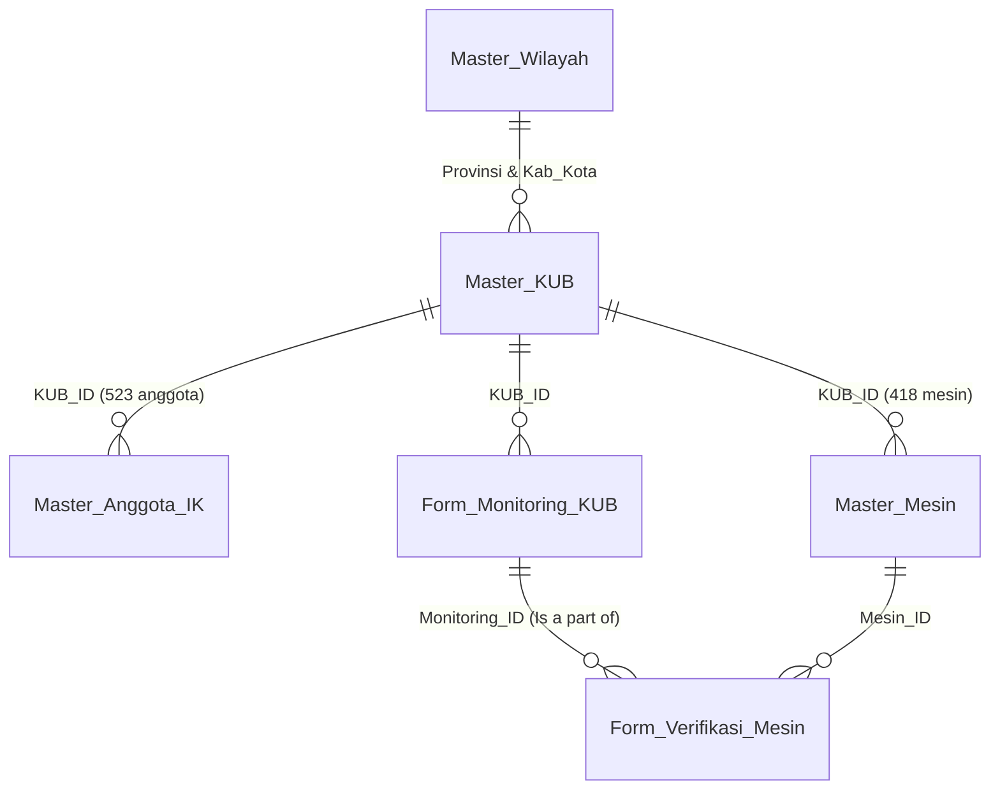

# PRD & Panduan Setup Google AppSheet (Offline & Online Backup)
## Monitoring & Verifikasi Bantuan Mesin/Peralatan PRRP Sumatera TA 2026 (Dit. LMEA)

| Atribut | Detail |
|---|---|
| **Tujuan** | Aplikasi pendamping/cadangan (*backup*) Google Form yang dapat berjalan **100% OFFLINE & ONLINE** di HP Android/iOS petugas lapangan |
| **Sumber Data** | Sinkronisasi 100% dari dataset yang sama (`3` Provinsi, `8` Kab/Kota, `52` KUB, `523` Anggota IK, `418` Jenis Mesin Unik) |
| **File Database Siap Pakai** | `appsheet/Database_AppSheet_PRRP_Sumatera_2026.xlsx` & 6 CSV di `appsheet/csv/` |
| **Generator Otomatis di Google** | Tombol **`Buat Database AppSheet (6 Tab Offline/Online)`** di Web App `/exec` atau fungsi `createAppSheetDatabase()` di `Kode.gs` |

---

## 1. Perbandingan Google Form (Apps Script) vs Google AppSheet

| Aspek | Google Form (Apps Script) | Google AppSheet (Backup Offline/Online) |
|---|---|---|
| **Koneksi Internet saat Isi** | Wajib ada sinyal internet | **Bisa 100% Offline** (otomatis sync saat ada sinyal) |
| **Dropdown Berjenjang** | Cabang per Section (`65` Section) | *Dependent Dropdown* dinamis (`Provinsi → Kab/Kota → KUB → Mesin`) dalam 1 layar bersih |
| **Auto-Tampil Data KUB & Mesin** | Blok teks statis per Section KUB | Relasi tabel (`Ref` + `Dereference`) langsung menampilkan profil KUB, anggota IK, dan detail 11 kolom mesin |
| **Foto Lapangan & Tanda Tangan** | Link folder Google Drive | **Kamera HP langsung (offline)**, GPS otomatis (`HERE()`), & tanda tangan di layar (`Signature`) |
| **Kapan Dipakai** | Pengisian cepat via browser/HP saat sinyal stabil | Lokasi blank-spot / tanpa sinyal, atau saat butuh foto mesin & tanda tangan langsung |

---

## 2. Arsitektur Database Relasional (6 Tabel)

1. **`Master_Wilayah` (8 baris — Read-Only):** Referensi jumlah KUB, IK, dan mesin per Kab/Kota.
2. **`Master_KUB` (52 baris — Read-Only):** Profil ringkas 52 KUB dengan `KUB_ID` sebagai *Primary Key*.
3. **`Master_Anggota_IK` (523 baris — Read-Only):** Seluruh 18 kolom anggota IK terhubung via `KUB_ID`.
4. **`Master_Mesin` (418 baris — Read-Only):** Seluruh 11 kolom spek teknis mesin terhubung via `KUB_ID`.
5. **`Form_Monitoring_KUB` (Tabel Input Utama — Adds & Updates):** Header kunjungan petugas, pilihan `Provinsi → Kab_Kota → KUB_ID`, checklist anggota hadir, foto lokasi/BAST, GPS, & tanda tangan.
6. **`Form_Verifikasi_Mesin` (Tabel Anak *Inline* — Adds & Updates):** Verifikasi tiap unit mesin milik KUB terpilih (`Status_Penerimaan_Spek`, `Volume_Diterima_Aktual`, `Status_Instalasi_Training`, `Nomor_Seri_Mesin`, `Foto_Mesin`).

---

## 3. Cara Membuat Aplikasi AppSheet dalam 5 Menit

### Langkah 1 — Siapkan Google Spreadsheet 6 Tab (Pilih Salah Satu)
- **Cara Paling Cepat (1 Klik di Web App):**
  1. Buka link Web App Anda: https://script.google.com/macros/s/AKfycbzwpzfgagbL6Ell1Wq9ymzratwj6IRRtuuTwiTf-JN9-GL4QBqTmLNV2_amEuVr9GVdSQ/exec
  2. Klik **`Buat Database AppSheet (6 Tab Offline/Online)`**.
  3. Klik **`Buka Database AppSheet`** yang muncul.
- **Atau Upload Manual Excel Lokal:**
  1. Upload file `appsheet/Database_AppSheet_PRRP_Sumatera_2026.xlsx` ke Google Drive.
  2. Buka dengan **Google Sheets** lalu klik **File → Simpan sebagai Google Sheets**.

### Langkah 2 — Generate Aplikasi AppSheet
1. Di Google Spreadsheet 6 tab tersebut, klik menu **Ekstensi (*Extensions*) → AppSheet → Buat aplikasi (*Create an app*)**.
2. Di Editor AppSheet, pastikan seluruh 6 tabel masuk (**Data → Tables**):
   - Jika ada tabel yang belum otomatis masuk, klik **+ Add Table** → pilih dari Google Sheet yang sama.
3. Atur mode akses tabel (**Table Settings**):
   - `Master_Wilayah`, `Master_KUB`, `Master_Anggota_IK`, `Master_Mesin`: set **`Updates` = Read-Only**.
   - `Form_Monitoring_KUB` & `Form_Verifikasi_Mesin`: set **`Updates` = Adds and Updates** (atau **All changes**).

---

## 4. Konfigurasi Kolom & Rumus AppSheet (Siap Copy-Paste)

### 4.1. Tabel Master (Read-Only)
- **`Master_Wilayah`**: Key = `Wilayah_ID`, Label = `Kab_Kota`.
- **`Master_KUB`**: Key = `KUB_ID`, Label = `Nama_KUB`.
- **`Master_Anggota_IK`**: Key = `IK_ID`, Label = `Label_Anggota`. Ubah tipe kolom `KUB_ID` menjadi **`Ref`** (Source table: `Master_KUB`).
- **`Master_Mesin`**: Key = `Mesin_ID`, Label = `Label_Mesin`. Ubah tipe kolom `KUB_ID` menjadi **`Ref`** (Source table: `Master_KUB`).

### 4.2. Tabel `Form_Monitoring_KUB` (Form Utama Petugas)

| Kolom | Type | Konfigurasi / Rumus (`Initial Value`, `App Formula`, `Valid_If`) | Wajib |
|---|---|---|---|
| `Monitoring_ID` | `Text` | **Key = ON**, Initial Value: `UNIQUEID()` *(Show = OFF)* | Ya |
| `Timestamp` | `DateTime` | Initial Value: `NOW()` *(Editable = OFF)* | Ya |
| `Nama_Petugas` | `Text` | Input manual | Ya |
| `Instansi_Petugas` | `Text` | Contoh: Dit. LMEA / Dinas Perindag | Ya |
| `HP_Petugas` | `Phone` | Nomor HP/WA aktif | Ya |
| `Tanggal_Kunjungan` | `Date` | Initial Value: `TODAY()` | Ya |
| `Tahap_Kunjungan` | `Enum` | Values: `Verifikasi Awal / Survei Kesiapan`, `Serah Terima / Pengiriman Mesin`, `Instalasi & Uji Coba (Commissioning)`, `Training Operator`, `Monitoring Pemanfaatan` | Ya |
| `Provinsi` | `Enum` | `Valid_If`: `SORT(Master_KUB[Provinsi], FALSE)` | Ya |
| `Kab_Kota` | `Enum` | `Valid_If`: `SORT(SELECT(Master_KUB[Kab_Kota], [Provinsi] = [_THISROW].[Provinsi], TRUE), FALSE)` | Ya |
| `KUB_ID` | `Ref` | Source table: `Master_KUB`, **Label**, `Valid_If`: `ORDERBY(SELECT(Master_KUB[KUB_ID], AND([Provinsi] = [_THISROW].[Provinsi], [Kab_Kota] = [_THISROW].[Kab_Kota])), [Nama_KUB])` | Ya |
| `Info_Ketua_Kontak` | `LongText` | `App Formula`: `[KUB_ID].[Ketua_Kontak]` *(otomatis terisi saat KUB dipilih!)* | - |
| `Info_Lokasi_Kec_Desa` | `LongText` | `App Formula`: `"Kec: " & [KUB_ID].[Kecamatan] & " | Desa/Kel: " & [KUB_ID].[Desa_Kel]` | - |
| `Info_Industri_Produk` | `LongText` | `App Formula`: `[KUB_ID].[Jenis_Industri] & " — " & [KUB_ID].[Jenis_Produk] & " (KBLI: " & [KUB_ID].[KBLI] & ")"` | - |
| `Info_Ringkasan_KUB` | `LongText` | `App Formula`: `"Anggota IK: " & [KUB_ID].[Jumlah_Anggota] & " orang (L:" & [KUB_ID].[Jumlah_Laki] & ", P:" & [KUB_ID].[Jumlah_Perempuan] & ") | Mesin: " & [KUB_ID].[Jumlah_Jenis_Mesin] & " jenis (" & [KUB_ID].[Total_Volume_Label] & ")"` | - |
| `Anggota_IK_Hadir` | `EnumList` | Base type: `Ref`, Referenced table: `Master_Anggota_IK`, `Valid_If`: `ORDERBY(SELECT(Master_Anggota_IK[IK_ID], [KUB_ID] = [_THISROW].[KUB_ID]), [No])` | Ya |
| `Nama_Perwakilan_KUB` | `Text` | Nama pengurus/anggota ditemui | Ya |
| `Jabatan_HP_Perwakilan` | `Text` | Jabatan & nomor HP perwakilan | Ya |
| `Kesiapan_Lokasi_Listrik` | `Enum` | Values: `Sangat Siap`, `Cukup Siap (Perlu Penyesuaian Ringan)`, `Belum Siap (Perlu Dukungan Infrastruktur)` | Ya |
| `Lokasi_GPS` | `LatLong` | Initial Value: `HERE()` | Tidak |
| `Foto_Lokasi_KUB` | `Image` | Kamera HP (tersimpan offline hingga sync) | Tidak |
| `Foto_BAST_Dokumen` | `Image` | Foto dokumen/BAST | Tidak |
| `Tanda_Tangan_Perwakilan` | `Signature` | Tanda tangan layar HP | Tidak |
| `Catatan_Umum` | `LongText` | Catatan & rekomendasi tindak lanjut | Tidak |
| `Konfirmasi_Petugas` | `Yes/No` | `Valid_If`: `[_THIS] = TRUE` | Ya |

> **Tips UX:** Untuk menampilkan daftar mesin milik KUB tersebut secara otomatis di halaman detail/form, aktifkan relasi **Parent-Child** pada tabel `Form_Verifikasi_Mesin` di bawah ini agar tombol **"New / Tambah Verifikasi Mesin"** langsung muncul di dalam form `Form_Monitoring_KUB`!

### 4.3. Tabel `Form_Verifikasi_Mesin` (Child Table — Inline di dalam Form KUB)

| Kolom | Type | Konfigurasi / Rumus | Wajib |
|---|---|---|---|
| `Verifikasi_ID` | `Text` | **Key = ON**, Initial Value: `UNIQUEID()` *(Show = OFF)* | Ya |
| `Monitoring_ID` | `Ref` | Source table: `Form_Monitoring_KUB`, **Is a part of = ON** *(wajib dicentang agar muncul inline di form induk!)* | Ya |
| `KUB_ID` | `Ref` | Source table: `Master_KUB`, Initial Value: `[Monitoring_ID].[KUB_ID]`, `Editable_If`: `FALSE` | Ya |
| `Mesin_ID` | `Ref` | Source table: `Master_Mesin`, **Label = ON**, `Valid_If`: `ORDERBY(SELECT(Master_Mesin[Mesin_ID], [KUB_ID] = [_THISROW].[KUB_ID]), [No])` | Ya |
| `Auto_Merk_Tipe` | `Text` | `App Formula`: `[Mesin_ID].[Merk_Tipe]` | - |
| `Auto_Spesifikasi` | `LongText` | `App Formula`: `[Mesin_ID].[Spesifikasi]` | - |
| `Auto_Jenis_Tipe_Energi` | `Text` | `App Formula`: `[Mesin_ID].[Jenis_Mesin] & " | " & [Mesin_ID].[Tipe_Mesin] & " | Energi: " & [Mesin_ID].[Sumber_Energi]` | - |
| `Auto_Volume_Target` | `Text` | `App Formula`: `[Mesin_ID].[Volume_Target] & " " & [Mesin_ID].[Satuan]` | - |
| `Auto_Wajib_Instalasi_Training` | `Text` | `App Formula`: `"Instalasi: " & [Mesin_ID].[Perlu_Instalasi] & " | Training: " & [Mesin_ID].[Perlu_Training]` | - |
| `Status_Penerimaan_Spek` | `Enum` | Values: `Sesuai Spek & Volume`, `Sesuai Spek (Volume Kurang)`, `Tidak Sesuai Spek`, `Belum Diterima`, `Rusak / Bermasalah` | Ya |
| `Volume_Diterima_Aktual` | `Number` | Jumlah fisik aktual diterima di lapangan | Ya |
| `Status_Instalasi_Training` | `Enum` | Values: `Sudah Instalasi & Training`, `Sudah Instalasi (Belum Training)`, `Belum Instalasi`, `Tidak Memerlukan` | Ya |
| `Nomor_Seri_Mesin` | `Text` | Serial number unit (opsional) | Tidak |
| `Foto_Mesin` | `Image` | Foto fisik mesin di lokasi | Tidak |
| `Catatan_Mesin` | `LongText` | Catatan selisih/kendala mesin | Tidak |

---

## 5. Pengaturan Mode OFFLINE & SYNC (Wajib Diaktifkan!)

Di Editor AppSheet, buka **Settings (ikon roda gigi) → Performance → Offline & Sync**, lalu aktifkan opsi berikut:
1. **Store content for offline use:** **ON** *(mengunduh seluruh 52 KUB, 523 IK, dan 418 spek mesin ke memori HP petugas sehingga bisa dibuka tanpa sinyal)*.
2. **Sync on start:** **ON** *(memperbarui cache master otomatis saat HP memiliki sinyal sebelum berangkat ke lokasi)*.
3. **Delayed sync:** **ON** *(petugas bisa menekan Save berulang kali saat offline tanpa menunggu koneksi; data masuk antrean kirim otomatis)*.
4. **Automatic updates:** **ON** *(begitu HP kembali mendapat sinyal 4G/WiFi, semua data + foto yang tersimpan di antrean otomatis terkirim ke Google Sheets)*.

### Cara Memasang di HP Petugas (Android & iOS)
1. Pastikan petugas sudah mengunduh aplikasi **AppSheet** dari Google Play Store / App Store dan login dengan akun Google yang diizinkan.
2. Buka link aplikasi yang dibagikan dari AppSheet (**Share → Copy sharing link**).
3. Saat masih ada internet/WiFi, buka aplikasinya sekali agar **cache offline (52 KUB & 418 mesin)** terunduh ke HP.
4. Di lokasi tanpa sinyal, petugas tetap bisa mengisi seluruh monitoring + foto kamera; setelah kembali ke area bersinyal, buka aplikasi atau tekan tombol **Sync** (ikon panah berputar di pojok kanan atas) jika antrean masih menunggu.

---

## 6. Cara Berbagi ke Amel & Tim Petugas
- **Berbagi Database ke Amel untuk Membuat AppSheet:** Bagikan Google Spreadsheet 6 tab hasil generator kepada email Amel (hak **Editor** jika Amel yang mengklik *Ekstensi → AppSheet*, atau cukup jalankan *Buat aplikasi* dari akun Anda lalu tambahkan email Amel sebagai **Co-Author** di Editor AppSheet).
- **Catatan Batas Akun Gratis AppSheet:** Mode *Prototype* gratis AppSheet mengizinkan **hingga 10 pengguna/petugas** tanpa biaya. Jika petugas lapangan yang mengakses bersamaan lebih dari 10 akun Google, gunakan lisensi Google Workspace/AppSheet Core atau gunakan **Google Form** untuk petugas selebihnya (keduanya menulis data dengan struktur yang seragam).
